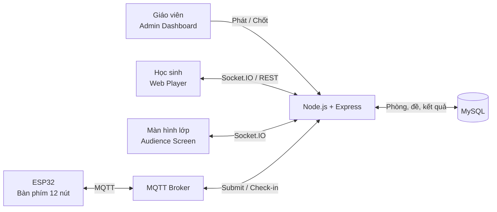
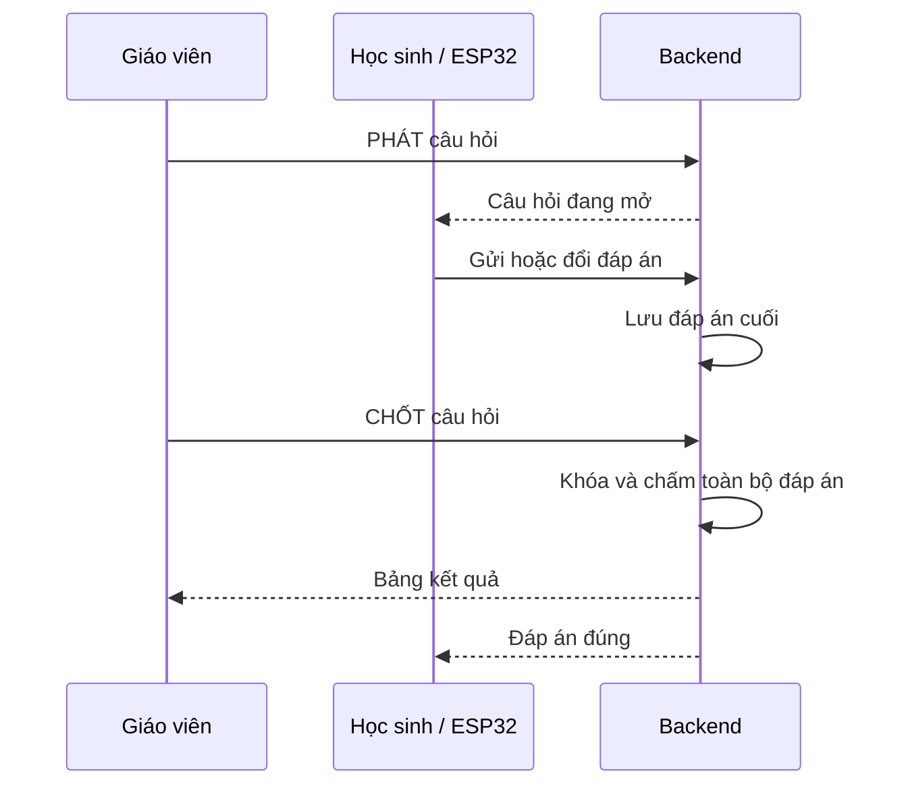

<div align="center">

# 🎓 WEDDONG QUIZ V2

### Hệ thống thi trắc nghiệm thời gian thực cho lớp học

Kết hợp **Web · ESP32 · MQTT · Socket.IO · MySQL** trong một nền tảng tương tác trực tiếp giữa giáo viên và học sinh.

[](https://react.dev/)
[](https://vite.dev/)
[](https://nodejs.org/)
[](https://www.espressif.com/)
[](https://mqtt.org/)
[](package.json)


</div>

## ✨ Tổng quan

WEDDONG QUIZ V2 giúp giáo viên tổ chức một phiên hỏi đáp trực tiếp trong lớp. Học sinh có thể tham gia bằng trình duyệt hoặc bộ bàn phím ESP32 chuyên dụng. Câu trả lời được gửi theo thời gian thực, hiển thị trên màn hình lớp và chỉ được chấm sau khi giáo viên **CHỐT** câu hỏi.

| Vai trò | Chức năng chính | Đường dẫn |
|---|---|---|
| 👩‍🏫 Giáo viên | Tạo phòng, nạp đề, quản lý lớp, phát/chốt câu và xem kết quả | `/admin` |
| 🧑‍🎓 Học sinh | Vào lớp bằng PIN và STT, gửi đáp án A–D | `/play` |
| 🖥️ Màn hình lớp | Hiển thị sảnh chờ, câu hỏi và kết quả trực tiếp | `/screen` |
| 🎛️ Thiết bị ESP32 | Check-in bằng STT và trả lời bằng bàn phím vật lý | MQTT |

## 🚀 Điểm nổi bật

- Đồng bộ thời gian thực giữa màn hình giáo viên, học sinh và máy chiếu bằng Socket.IO.
- Hỗ trợ đồng thời người chơi Web và thiết bị ESP32 qua MQTT.
- Cho phép đổi đáp án nhiều lần trước khi giáo viên chốt; chỉ đáp án cuối cùng được tính.
- Quản lý phòng thi, PIN tham gia, danh sách học sinh, đề thi và bảng kết quả.
- Nhập nhanh danh sách lớp, câu hỏi và ánh xạ thiết bị từ tệp văn bản.
- Khôi phục trạng thái câu hỏi đang diễn ra sau khi backend khởi động lại.
- Bảo vệ API quản trị bằng mật khẩu và token có thời hạn.
- Giao diện responsive, phù hợp máy tính, máy chiếu và điện thoại.

## 🧩 Kiến trúc hệ thống



### Luồng chấm điểm



## 🖼️ Thiết kế phần cứng

### Mạch PCB bàn phím ESP32

<table>
  <tr>
    <td align="center" width="50%"><br><b>Phối cảnh mặt trên</b></td>
    <td align="center" width="50%"><br><b>Phối cảnh hoàn thiện</b></td>
  </tr>
  <tr>
    <td align="center"><br><b>Layout mặt trước · 60 × 90 mm</b></td>
    <td align="center"><br><b>Layout mặt sau</b></td>
  </tr>
</table>

<details>
<summary><b>Xem thêm mặt dưới PCB và thiết kế vỏ 3D</b></summary>
<br>
<table>
  <tr>
    <td align="center" width="33%"><br><b>Mặt dưới PCB</b></td>
    <td align="center" width="33%"><br><b>Vỏ thiết bị 3D</b></td>
    <td align="center" width="33%"><br><b>Mặt trên của vỏ</b></td>
  </tr>
</table>
</details>

### Sơ đồ phím

| Phím | GPIO | Lúc nhập STT | Lúc làm bài |
|:---:|:---:|---|---|
| `1` / `2` / `3` / `4` | 16 / 23 / 26 / 17 | Nhập số tương ứng | Chọn A / B / C / D |
| `5` / `6` / `7` / `8` | 25 / 27 / 18 / 33 | Nhập số tương ứng | — |
| `9` / `0` | 14 / 32 | Nhập số tương ứng | — |
| `*` RESET | 19 | Xóa STT | Rời phiên, nhập lại STT |
| `#` ENTER | 13 | Xác nhận STT | Gửi đáp án |
| LED | 21 | Báo trạng thái kết nối | Báo trạng thái câu trả lời |

## 🛠️ Công nghệ

| Thành phần | Công nghệ |
|---|---|
| Frontend | React 19, Vite 8, Tailwind CSS, React Router, Lucide Icons |
| Backend | Node.js, Express 5, Socket.IO |
| Database | MySQL |
| IoT | ESP32, PubSubClient, MQTT |
| Broker mặc định | EMQX Public Broker |
| Triển khai gợi ý | Netlify cho frontend, Render cho backend |

## ⚡ Chạy nhanh trên máy

### 1. Yêu cầu

- Node.js 20 trở lên và npm
- MySQL đang hoạt động
- Arduino IDE và thư viện PubSubClient nếu dùng ESP32

### 2. Chạy backend

```bash
cd Backend
cp .env.example .env
# Điền thông tin MySQL và mật khẩu quản trị trong .env
npm ci
npm test
npm start
```

Backend mặc định chạy tại `http://localhost:3000`. Kiểm tra bằng `http://localhost:3000/api/health`.

### 3. Chạy frontend

Mở terminal khác:

```bash
cd frontend/frontend
npm ci
npm run dev
```

Mở `http://localhost:5173`. Khi truy cập từ điện thoại, máy tính và điện thoại cần ở cùng Wi-Fi; dùng địa chỉ IP LAN của máy tính thay cho `localhost`.

### 4. Nạp dữ liệu mẫu

1. Vào `/admin`, đăng nhập và tạo một phòng học.
2. Mở **Sổ Đầu Bài**, nạp `DU_LIEU_MAU/01_DANH_SACH_LOP_MAU.txt`.
3. Mở **Nạp câu hỏi**, nạp `DU_LIEU_MAU/02_DE_MAU_RTOS_10_CAU.txt`.
4. Mở `/screen?pin=<MÃ_PIN>` trên máy chiếu.
5. Học sinh vào `/play` hoặc check-in bằng ESP32 để bắt đầu.

> [!IMPORTANT]
> Không commit file `.env`. Khi triển khai thật, hãy đặt `ADMIN_PASSWORD` và `ADMIN_TOKEN_SECRET` mạnh, dùng MQTT riêng có TLS/xác thực và sao lưu database trước khi nhập dữ liệu mới.

## 📁 Cấu trúc dự án

```text
WEDDONG_QUIZ_V2_FULL/
├── Backend/                  # REST API, Socket.IO, MQTT và MySQL
├── frontend/frontend/       # Ứng dụng React cho 3 giao diện
├── ESP32/                   # Firmware Arduino cho bàn phím vật lý
├── DU_LIEU_MAU/             # Danh sách lớp, đề và mapping mẫu
├── docs/images/             # Hình ảnh PCB và thiết kế vỏ
├── CHAY_WEB_CUNG_WIFI.md     # Hướng dẫn dùng trong mạng LAN
└── README_HUONG_DAN_CHAY.md  # Hướng dẫn kiểm thử chi tiết
```

## 📚 Tài liệu chi tiết

- [Hướng dẫn cài đặt và kiểm thử đầy đủ](README_HUONG_DAN_CHAY.md)
- [Chạy Web trên điện thoại cùng Wi-Fi](CHAY_WEB_CUNG_WIFI.md)
- [Hướng dẫn cập nhật dự án](HUONG_DAN_CAP_NHAT.txt)
- [Dữ liệu mẫu](DU_LIEU_MAU/00_DOC_TRUOC.txt)

## ⚠️ Phạm vi hiện tại

Đây là bản phục vụ học tập và kiểm thử. Broker MQTT công cộng không xác thực từng thiết bị; hệ thống hiện điều phối một câu hỏi MQTT đang mở tại một thời điểm. Trước khi dùng cho kỳ thi thực tế, cần kiểm thử tải, bảo vệ broker bằng TLS, xác thực thiết bị và cấu hình hạ tầng riêng.

---

<div align="center">
  <b>WEDDONG QUIZ V2</b><br>
  Học tập tương tác · Phản hồi thời gian thực · Kết nối phần cứng
</div>
